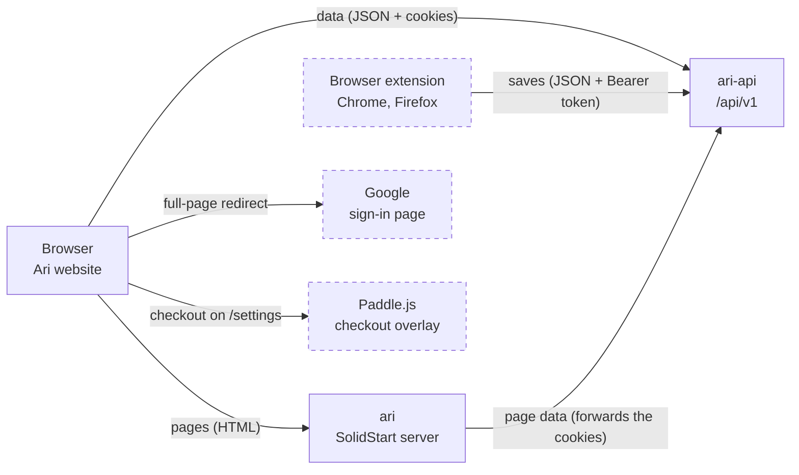
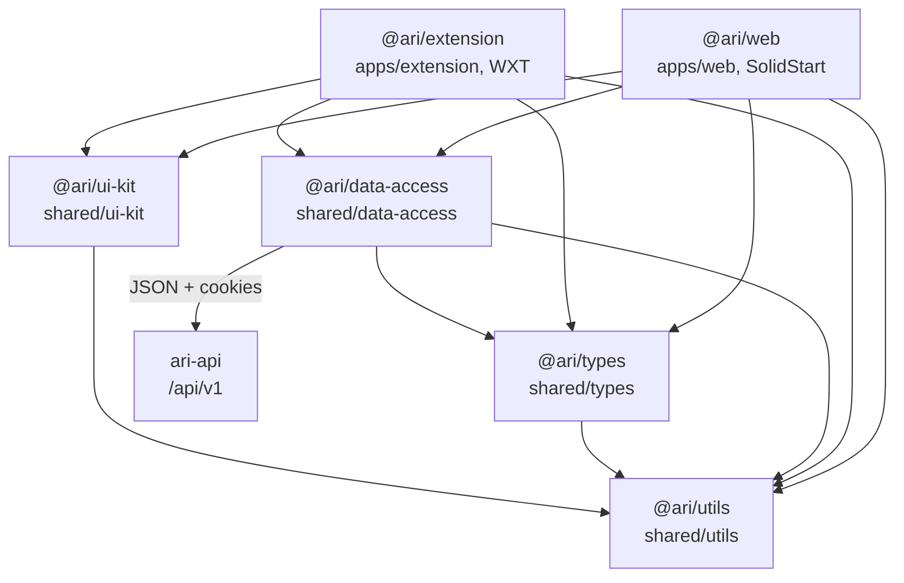

# Ari frontend architecture

Last updated 2026-10-08. The docs in this repo cover only the frontend: the website, the `ari`
server, the extension and their UI. The request flows are in [sequences.md](sequences.md). The
backend (database, queues, webhooks) is documented in ari-api. Read this together with
`.claude/skills/ari/SKILL.md`. If the two ever disagree, ask before writing code.

Feature numbers (F1, F2, F9…) match the GitHub issues on the "Ari" project board.

## 1. How the frontend connects

Dashed boxes and arrows are later features: the extension exists (`apps/extension`, Firefox, not
on addons.mozilla.org yet), signs in with the website and sends its saves to the library.

Key decisions:

- The browser gets **pages** from the `ari` server. While rendering, the server calls `ari-api` with
  the browser's cookies and puts the data in the HTML
  ([sequences §4](sequences.md#4-server-rendered-library-page-f2)). After hydration, the browser
  calls `ari-api` directly with the cookies.
- The extension (F13) calls `ari-api` directly with an `Authorization: Bearer` token of its own
  session, which a signed-in website page starts by handing it a one-time code
  ([sequences §7](sequences.md#7-save-from-the-extension-f13)). Its saves are kept in
  `browser.storage.local`, one key per page, shaped like ari-api's `CreateSaveRequest`, so the page
  can mark them; the background sends each one to `POST /saves`, and later changes and deletions
  after it. Saves made while signed out wait there for the next sign-in.
- Google sign-in (F9) is a full-page link through `ari-api`, and checkout (F15) is Paddle.js on
  `/settings`. The frontend never talks to the database, queues or file storage.
- Local URLs: web `http://localhost:3000`, API `http://localhost:8080`, API base path `/api/v1`.

## 2. Sign-in and errors the UI relies on

The flows are in sequences [§1](sequences.md#1-register-or-sign-in-f1),
[§2](sequences.md#2-token-refresh-f1) and [§3](sequences.md#3-sign-in-with-google-f9).

| Rule | Value |
|---|---|
| Cookies | `ari_access` (15 minutes) and `ari_refresh` (30 days, `Path=/api/v1/auth`, replaced on every refresh), both httpOnly; and `ari_access_fresh` (13 minutes, readable by JavaScript, no token in it), which tells an upload to refresh first |
| Cookie flags | `HttpOnly`, so JavaScript never reads or stores tokens; `SameSite=Lax`; `Secure` outside dev |
| Logout | `POST /api/v1/auth/logout` clears both cookies (204) |

Errors are RFC 9457 Problem Details with a stable `code`:

| Code | Status | When |
|---|---|---|
| `INVALID_CREDENTIALS` | 401 | Login fails, for any reason; it never says which usernames exist |
| `USERNAME_TAKEN` | 409 | Register, or save the profile with, a username that is already used; the profile form shows it on the field |
| `INVALID_PHOTO` | 400 | A profile photo that isn't a JPEG, PNG or WebP image (the photo card's type error) |
| `FILE_TOO_LARGE` | 413 | An upload over the server's limit, 2 MB for a profile photo (the photo card's size error) |
| `RATE_LIMITED` | 429 | Too many verify links (1 a minute, 5 a day): the email section says to try again later |
| `INVALID_CODE` | 401 | `/verify-email` with an unknown, expired or used link; called with `refresh: false`, so it never means "signed out" |
| `EMAIL_TAKEN` | 409 | `/verify-email` for an address another account confirmed first |
| `CODE_EXPIRED` | 410 | Planned: a password reset link older than 30 minutes; `/reset-password` offers a new one ([sequences §11](sequences.md#11-reset-a-forgotten-password)) |
| `CODE_USED` | 410 | Planned: a password reset link that already set a password; `/reset-password` offers Log in |
| `ACCOUNT_NOT_FOUND` | 404 | Planned: no account has the username or email a reset link was asked for; `/forgot-password` links to `/register` |
| `NO_EMAIL` | 409 | Planned: the account has no email to send a reset link to |
| `EMAIL_NOT_CONFIRMED` | 409 | Planned: the account's email isn't confirmed yet, so it gets no reset link |
| `UNAUTHORIZED` | 401 | No valid session: refresh once, then go to `/login` |
| `VALIDATION_FAILED` | 400 | An invalid body, with field errors |
| `UNSUPPORTED_FILE` | 400 | An imported file that isn't a PDF or Word DOCX by its bytes: "Ari can import PDF and Word (DOCX) files" |
| `NO_SPACE_LEFT` | 400 | An imported file that doesn't fit in what is left of the 50 MB upload space |
| `FILE_TOO_LARGE` | 413 | An upload over its limit: 50 MB (the whole upload space) for an imported file, 2 MB for a photo or a clip's image |
| `INVALID_IMPORT_STATE` | 409 | An import action its status doesn't allow, e.g. a review before the file is read |
| `LIMIT_REACHED` | 403 | Planned with billing: a save past a plan's limit |
| `NOT_FOUND` | 404 | A folder or highlight that isn't the user's |

## 3. Frontend workspace and UI

`ari` is a Turborepo + pnpm workspace. Apps live in `apps/`, and the code they share lives in four
packages in `shared/`, following Nx's library types (data-access, ui, util, plus types). There are no `lib/`
folders.

The arrows are the only allowed imports. `ui-kit` and `data-access` never import each other, `utils`
imports no workspace package, and only `data-access` calls `ari-api`.

| Package | Folder | Holds |
|---|---|---|
| `@ari/web` | `apps/web` | File routes (`routes/`); features (`features/<name>/`: `queries.ts` with the router's `query` and `action`, and the feature's components); page layout styles |
| `@ari/extension` | `apps/extension` | The Firefox extension (WXT): `entrypoints/` (background, the content script's shadow-root UI with the side panel, popup, welcome tab) and `features/<name>/` (account, saves, highlight, clip, page, popup, side-panel, welcome) |
| `@ari/data-access` | `shared/data-access` | The API client, the only code that calls `ari-api` |
| `@ari/types` | `shared/types` | API types, generated from ari-api's OpenAPI (`pnpm generate:api`) into `schema.ts`, named per area (`auth.ts`, `users.ts`) |
| `@ari/ui-kit` | `shared/ui-kit` | Design-system components (thin Kobalte wrappers where Kobalte has the primitive), `AsyncBoundary` (Suspense + ErrorBoundary), `tokens.css`, `base.css` |
| `@ari/utils` | `shared/utils` | Pure helpers: no UI, no API calls (the OpenAPI type helpers, and the messages the website and the extension post each other) |

Workspace rules:

- Apps link the shared packages with `workspace:*`.
- Shared packages are Just-in-Time: `exports` points at `./src/index.ts`, there is no build step,
  and Vite compiles them inside the app. Turborepo still hashes their files into the app's build,
  so a change in `shared/` rebuilds the app.
- Single version policy: each external dependency's version is set once in the `catalog` of
  `pnpm-workspace.yaml`, and every `package.json` asks for `catalog:`. `catalogMode: strict`
  rejects any other version.
- Every `tsconfig.json` extends the root `tsconfig.base.json`. No TypeScript project references,
  and no `paths` aliases inside shared packages.

Client and UI rules:

- Pages render on the server first (SolidStart). Data goes through the router's `query`,
  `createAsync` and `action`; no data-fetching library.
- Components live in `@ari/ui-kit`, built on Kobalte where it has the primitive, and are styled
  with Sass: one Sass Module per component, with variants and Kobalte states styled through
  `[data-*]` attributes. No other UI kit or CSS framework.
- Kobalte 0.13 has no date picker, and Kobalte 2 needs Solid 2, so `DatePicker` is ari's own: a
  Kobalte `Popover` holding a calendar built with date-fns. Dates are `dd.MM.yyyy` strings
  (`dateFormat`, e.g. `12.05.1995`). Month and weekday names come from date-fns locales
  (`useI18n().dateLocale()`), not `Intl`, which has no Azerbaijani dates in Chrome and may format
  differently on the server.
- Design tokens are `--ari-*` CSS variables in `tokens.css`, taken from the design handoff's
  `ari.tokens.json`: primitives (palette, fonts, spacing, radius, shadows), then the semantic
  tokens components read (colors, type, shape, elevation, sizes). The design has a light theme
  only.
- Global styles (the `@font-face` rules, a small reset and page defaults) are in `base.css`. The
  app imports `@ari/ui-kit/tokens.css`, then `@ari/ui-kit/base.css`, once in `app.tsx`. The fonts
  (Figtree, Source Serif 4) are self-hosted variable woff2 files in `ui-kit`'s `fonts/`, which Vite
  bundles with the app; no font CDN.
- Each component has its own folder in `ui-kit`: `<component>.tsx` and `<component>.module.scss`.
  Shared Sass mixins are in `styles/mixins.scss`.
- Only base components, and they are pure: one never imports another. Anything combining several
  (a toast with actions, a search field with a shortcut, whole screens) belongs in features.
- Every file and folder name is lowercase kebab-case (`text-field.tsx`, `text-field.module.scss`),
  and so is every class name (`.label-row`, read as `styles['label-row']`). Biome enforces it for
  code files.
- Every page handles loading, empty and error states; `AsyncBoundary` covers loading and errors.
- Forms use TanStack Form: one `createForm` per form with a Valibot schema as its `onDynamic`
  validator, so errors show after the first submit and then follow typing. Schema messages are
  dictionary keys, translated when shown.
- Every field has a visible label above it, which says what to enter. A placeholder only shows a
  format that isn't obvious (date `DD.MM.YYYY`); fields like name, username or password get
  none. Format examples are the same in every language, so they are
  written in the form, not the dictionaries. A hint that must stay visible while typing goes in the
  field's `description`, below it.
- UI text says "Ari"; code, package names and URLs say `ari`.

Extension rules:

- What it draws on a website lives in a shadow root (WXT's `createShadowRootUi`), so the page's
  styles can't reach it; only the highlight marks sit in the page, with inline styles.
- A highlight is found again on every visit by its words and the text around them, never by the
  page's DOM path, which changes between visits.
- Pages and the extension's parts talk through the typed messages in `src/messages.ts`; only the
  background captures the screen, opens tabs and calls `ari-api`.
- The website and the extension talk only on the website's own origin, through `window.postMessage`
  and `@ari/utils`' `BridgeMessage`: who is signed in, a sign-in code, and logging out. That is all
  the extension does there: Ari's own pages get no toolbar, side panel or clipping. By default
  signing in or out on the website does the same for the extension in that browser; an account
  signed in with its password in the popup stays until the extension logs out. After its own Sign
  out, the website's codes no longer sign it in: only an account's password in the popup does.
- A page shows the saves kept only in this browser and those of the signed-in account; another
  account's synced saves stay hidden until it signs in again.
- Ari never reads a page by itself: the content script acts on a selection, a copy while the side
  panel is open, or clip mode.

## 4. Implementation guide for Claude Code

Work one feature at a time, and give a plan before writing code.

- The API client in `@ari/data-access` sends every request with `credentials: 'include'`. On a 401
  it calls `POST /api/v1/auth/refresh` once (one shared promise when several requests fail at the
  same time), then retries. If the refresh fails, it goes to `/login`. JavaScript never reads or
  stores tokens.
- On the server, the API client forwards the browser's `Cookie` header, and the middleware
  refreshes first when `ari_access` is missing ([sequences §2](sequences.md#2-token-refresh-f1)).
- `/login` and `/register` call the auth endpoints and then go to `/library`. Logout calls
  `POST /api/v1/auth/logout`, then goes to `/login`.
- "Continue with Google" (F9) is a normal link to `http://localhost:8080/oauth2/authorization/google`
  (a full-page navigation, not `fetch`). Show a message when `/login?error=google` comes back.

Tests that prove it works: the API client in `@ari/data-access` refreshes once and retries, and goes
to `/login` when the refresh fails.
