# Ari sequences

Last updated 2026-10-14. This copy keeps only what the website, the `ari` server and the extension
send and receive. The server-side steps (database, queues, webhooks) are documented in ari-api.
The rules the UI relies on are in [architecture.md](architecture.md).

1. [Register or sign in (F1)](#1-register-or-sign-in-f1)
2. [Token refresh (F1)](#2-token-refresh-f1)
3. [Sign in with Google (F9)](#3-sign-in-with-google-f9)
4. [Server-rendered library page (F2)](#4-server-rendered-library-page-f2)
5. [Save and delete a highlight, free limit (F3, F4)](#5-save-and-delete-a-highlight-free-limit-f3-f4)
6. [PDF or Word import (F5, F11)](#6-pdf-or-word-import-f5-f11)
7. [Save from the extension (F13)](#7-save-from-the-extension-f13)
8. [Paddle checkout (F15)](#8-paddle-checkout-f15)
9. [Add and verify an email](#9-add-and-verify-an-email)
10. [Profile and photo](#10-profile-and-photo)
11. [Reset a forgotten password](#11-reset-a-forgotten-password)
12. [Sources](#12-sources)
13. [Notes](#13-notes)

## 1. Register or sign in (F1)

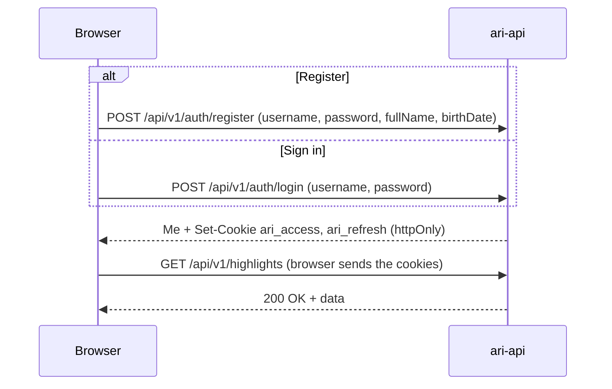

## 2. Token refresh (F1)

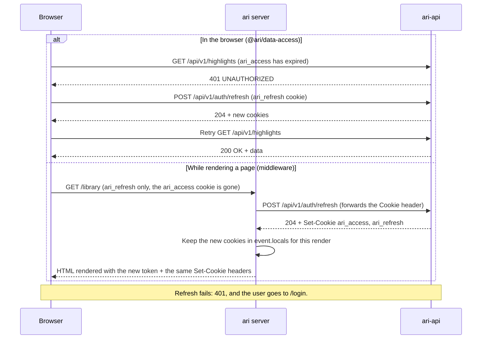

- In the browser, several 401s at once share one refresh request.
- The `ari` server refreshes only when `ari_access` is missing. The cookie expires a minute before its
  JWT, so a cookie the browser still sends is always valid.
- Beside them ari-api sets `ari_access_fresh=1`, readable by page JavaScript and holding no token,
  which goes a minute before `ari_access`. An upload checks it first and refreshes when it is gone,
  so a file is never sent just to get a 401 and go again (data-access' `upload`).

## 3. Sign in with Google (F9)

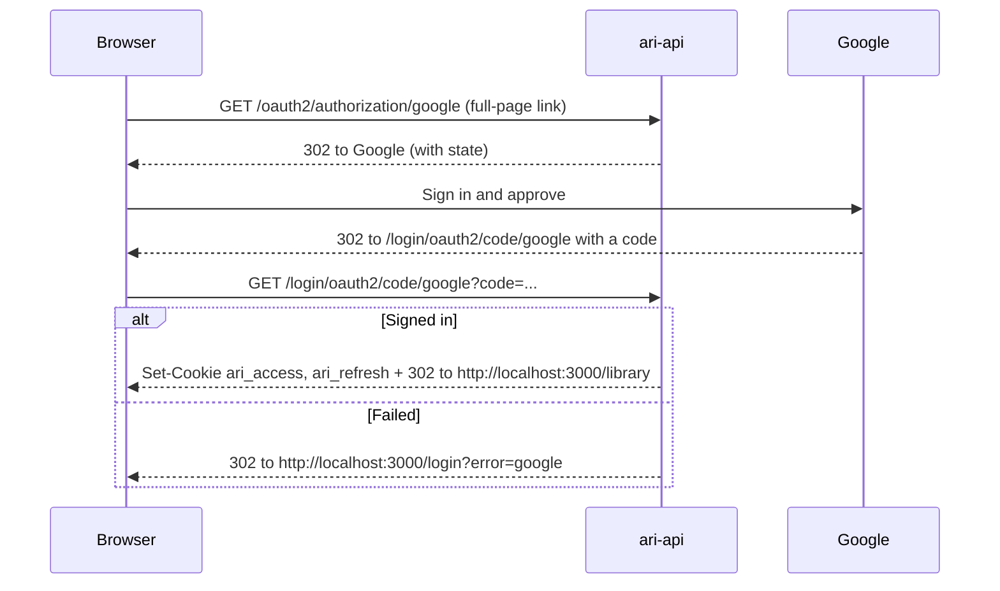

## 4. Server-rendered library page (F2)

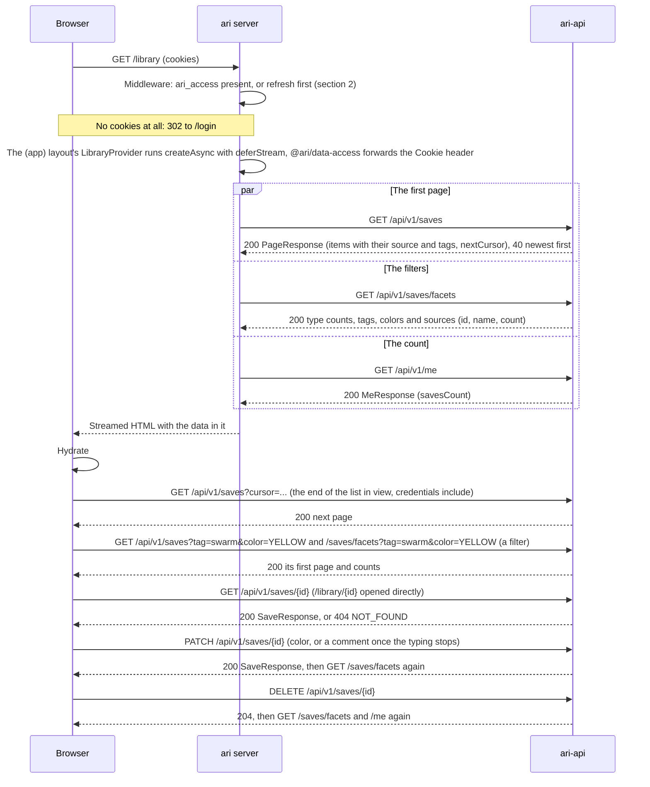

- `features/library/queries.ts` holds the queries (`getSavePage`, `getSaveFacets`, `getSave`) and
  the actions (`changeSaveAction`, `deleteSaveAction`). The actions revalidate only the counts they
  change, never the pages the list has loaded; the store shows a change at once and puts it back
  with a toast when ari-api refuses it.
- Filters (type, tags, colors, source ids) live in the store, not the URL: a reload starts from the
  whole Library. A filter change runs in a transition, so the list stays until ari-api answers.
- `nextCursor` is opaque: send it back as `cursor` for the next page. It is left out on the last
  page. ari-api can't start a page at a date, so the month jump loads pages until it gets there.
- A failed request is the query's `failed` answer, not a thrown error: the list shows "Your library
  didn't load" with Try again, while the sidebar and search go on.
- Search (`q`, F10) is a filter like the others: `GET /saves?q=` and `/saves/facets?q=`. A save
  matches when the words start words of its text, comment or section, or of its source's name,
  title or author, or when the whole search is part of its text; accents and case don't count. The
  palette asks for the first page and the counts 250 ms after the typing stops, showing the loaded
  saves meanwhile; "All N results" puts the search in the Library's filters, where that page is
  cached already. In the same round it asks `GET /sources?q=` (name, title, author) and
  `GET /notes?q=` (title and writing) for its Sources and Notes groups. The notes' "/" quote
  picker searches saves the same way. Sources has endpoints of its own (section 12).

## 5. Save and delete a highlight, free limit (F3, F4)

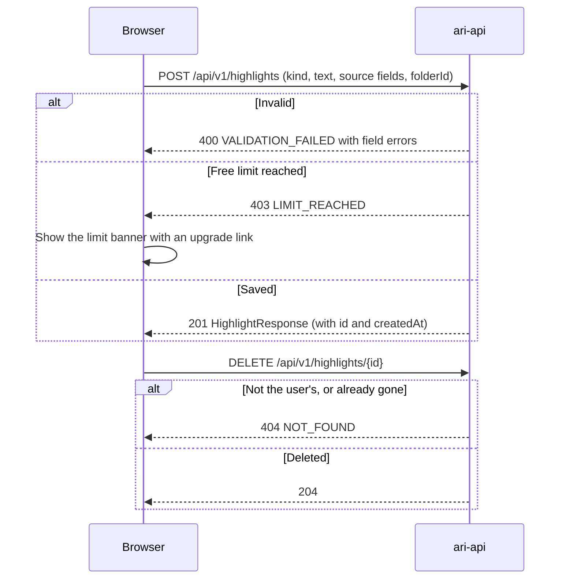

- Free means at most 500 highlights stored at once: deleting gives the save back. Pro has no limit.
  Folders don't count.
- `GET /me` returns `plan`, `savesCount` and `savesLimit`; `/settings` shows them, and the banner shows
  once `savesCount` reaches `savesLimit`.

## 6. PDF or Word import (F5, F11)

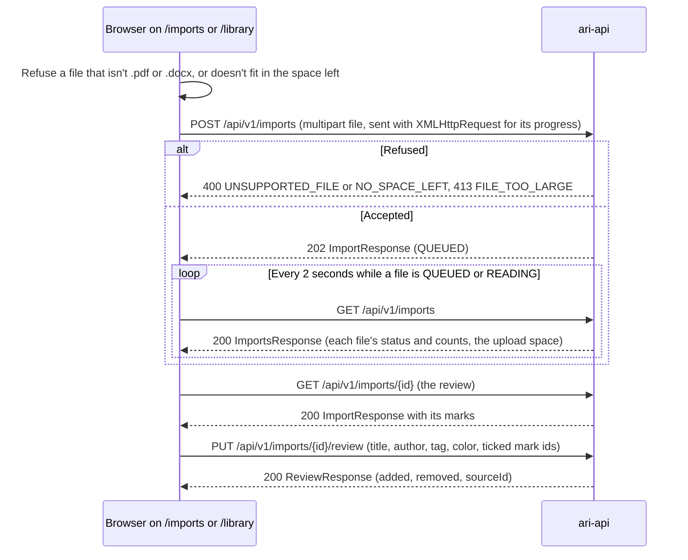

- ari-api reads the file in the background (its sequences §5): `QUEUED` → `READING` → `READY` with
  marks, `EMPTY` without, or `FAILED` (`UNREADABLE`, `ENCRYPTED`, `READ_FAILED`). Saving the review
  makes it `SAVED`; it can be reviewed again, and unticking a saved mark deletes its save.
- Retry (`POST /imports/{id}/retry`) reads a failed file again; Dismiss (`POST /imports/{id}/dismiss`)
  hides a failed, empty or discarded one; Discard (`DELETE /imports/{id}`) drops a file before its
  review.
- Everyone has 50 MB of upload space, in files of any size that fit in what is left, until billing
  (F15) gives plans their own; a file read and saved keeps counting.
- Photos are not imported yet: OCR in the browser comes with F12.

## 7. Save from the extension (F13)

```mermaid
sequenceDiagram
  participant X as Extension
  participant T as Website tab
  participant A as ari-api
  Note over X,A: Connect, on any signed-in page of the website
  T->>X: postMessage signed-in (the user's id)
  X->>T: postMessage want-code (not signed in as that user)
  T->>A: POST /api/v1/me/extension-code (cookies)
  A-->>T: 200 with the code
  T->>X: postMessage code
  X->>A: POST /api/v1/auth/extension/token (code)
  alt Missing, expired or used
    A-->>X: 401 INVALID_CODE
  else Found
    A-->>X: 200 accessToken, refreshToken
    X->>X: Keep the tokens in browser.storage.local
    X->>A: GET /api/v1/me (Bearer token)
  end
  Note over X,A: Or another account, with its password in the popup (Add an account, the switcher)
  X->>A: POST /api/v1/auth/extension/code (username, password; the website's cookies stay)
  A-->>X: 200 with the code, or 401 INVALID_CREDENTIALS (still the same account)
  X->>A: POST /api/v1/auth/extension/token (code), as above
  Note over X,A: Send the saves kept in the browser
  X->>A: POST /api/v1/saves (JSON, or multipart save and image for an image clip)
  alt Refused
    A-->>X: 400 VALIDATION_FAILED, INVALID_SAVE, INVALID_URL, or 413 FILE_TOO_LARGE
    X->>X: Keep it in the browser only, marked refused
  else Saved
    A-->>X: 201 SaveResponse (its id)
  end
  X->>A: PATCH /api/v1/saves/{id} (color, comment, tags changed after it was sent)
  X->>A: DELETE /api/v1/saves/{id} (deleted after it was sent)
  Note over X,A: Access token expired
  X->>A: POST /api/v1/auth/extension/refresh (refreshToken)
  alt Refreshed
    A-->>X: 200 new pair
  else Session over
    A-->>X: 401
    X->>X: Session expired: keep whose it was, until their password signs it in again
  end
  Note over X,A: Log out on the website (while the extension follows it)
  T->>X: postMessage signed-out
  X->>A: POST /api/v1/auth/extension/logout (refreshToken)
  A-->>X: 204
```

- Saves are kept in `browser.storage.local` (the welcome tab's practice ones in `storage.session`,
  never sent). The background (`features/saves/sync.ts`) sends them a second after each change,
  when someone signs in, at browser start and on the popup's Sync now: deletions first, then each
  page's saves in order. A save keeps its library id and the account (`remoteId`, `owner`); a page
  shows only the saves kept here and the signed-in account's. Saves made while signed out, or not
  sent yet, go to whoever signs in next ("will move to the account you switch to").
- A 5xx, 408, 429 or a failed fetch stops the round and tries again 1, 2, 5, 10, then every 30
  minutes (`browser.alarms`, `local:syncRetry`); a 4xx refuses that save only. A 404 on PATCH means
  it was deleted in the library, so it leaves the page too. Undo of a delete sends the save again
  as new.
- The Ari icon's badge counts the saves kept only here: terracotta while signed out or expired,
  gray while ari-api can't be reached. The popup says the same, with Sign in to sync or Sync now.
- The messages are `@ari/utils`' `BridgeMessage`, posted with `window.postMessage` to the website's
  own origin. The content script takes them only there (`VITE_WEB_URL`), and the background takes a
  code only from a tab on that origin, so no other site can sign the extension in as somebody else.
  The web side is `useExtensionSignIn` (in the shell's `UserChip`) and `logoutAction`.
- The code works once, for 60 seconds. A signed-out tab posts nothing: the extension's Sign in
  opens `/library`, which goes to `/login` first and then back. `signed-in` carries the user's id,
  username, name and email, which the extension keeps as `local:websiteAccount` for the popup.
- By default the extension uses the website's account and follows it, to another account and out.
  Signing in happens in the popup, never on a page of the website for the extension: Add an
  account (from Continue as's Use a different account, the switcher, or the welcome tab's Not you?,
  which opens the popup through `session:addAccountNext`) takes any account's username and
  password, and the switcher asks the password of an account used before. The background gets a
  code from `POST /auth/extension/code` and swaps it as above; the website stays as it is, and the
  extension keeps that account whatever the website does (`local:followsWebsite` false, unless it
  is the website's account).
- The popup's avatar opens the account switcher: the account in use, the website's ("on ari.app")
  and the others used here (`local:knownAccounts`), Add another account and Sign out. Forgot
  password? and Reset password open `/forgot-password?login=` on the website. When the website is
  signed in as another account than the one the extension keeps, the popup offers Use ari.app
  account (that account's password) or Keep (`local:keptBeside`).
- The extension's session is its own: it stays signed in while the website's cookies expire, and
  each refresh or browser start gives it 30 more days. A refused refresh leaves it expired
  (`local:expired`): the popup says so, and Sign in again asks that account's password. Sign out in
  the popup signs out only the extension and forgets the accounts it used (`local:loggedOut`).
  While expired or after a Sign out, the website's codes don't sign it in: the content script
  stops asking for them and the background refuses them. Only a password in the popup signs it
  in again: Continue as asks the website account's, the other Sign in buttons open Add an
  account. The website's codes sign the extension in only while it follows the website: at
  install, and when the website signs in after it logged out (not a Sign out).
- The extension calls `ari-api` from its background script with `credentials: 'omit'`: ari-api
  reads the `ari_access` cookie before the `Authorization` header. Firefox sends those requests with
  `Origin: moz-extension://<uuid>`, which ari-api's CORS allows by pattern, without credentials.
- The extension sends the page's address as `source.url`. Clips (F14) use the same `POST /saves`:
  a table with `kind CLIP` and `contentMd`, an image as multipart.

## 8. Paddle checkout (F15)

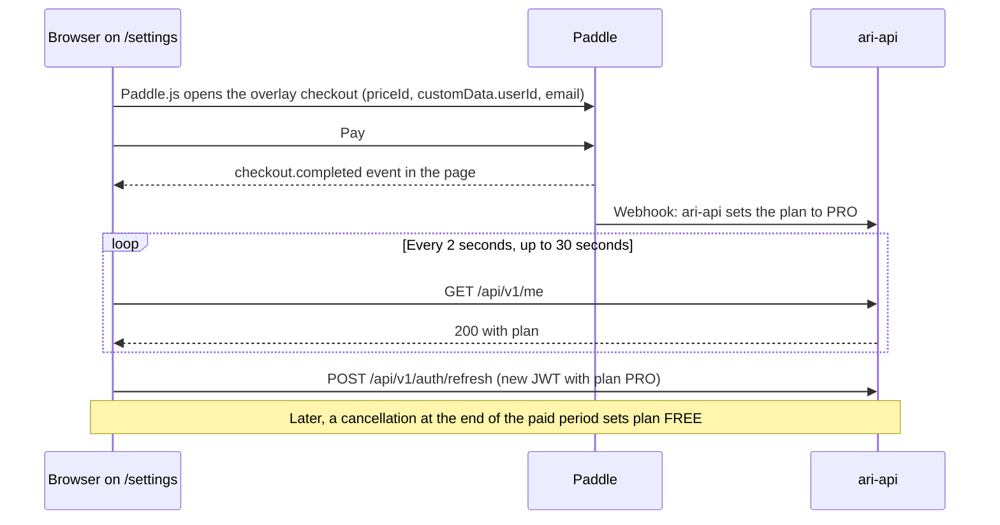

- The plan changes when ari-api gets Paddle's webhook, not when the page sees `checkout.completed`;
  that's why the page polls `/me`.
- Downgrading deletes nothing. A Free user above 500 keeps every highlight but can't save until under
  500.
- Prices: Pro is $6/month or $48/year, the same everywhere.

## 9. Add and verify an email

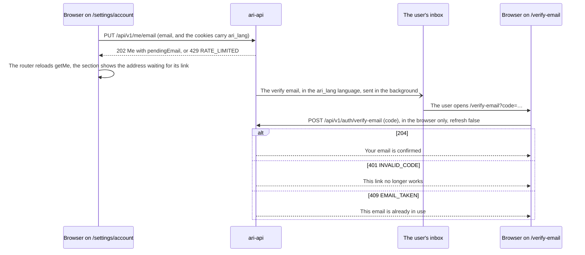

- A verified email keeps working while a new one waits for its link; the section says so.
- Resend (`POST /me/email/resend`, 202) and remove (`DELETE /me/email`, 204) reload `getMe` the
  same way. Over the limits, the section shows `RATE_LIMITED`'s text.
- `/verify-email` confirms in `onMount`, never while the server renders, so a mail scanner that only
  fetches the link's HTML can't use up the single-use code.

## 10. Profile and photo

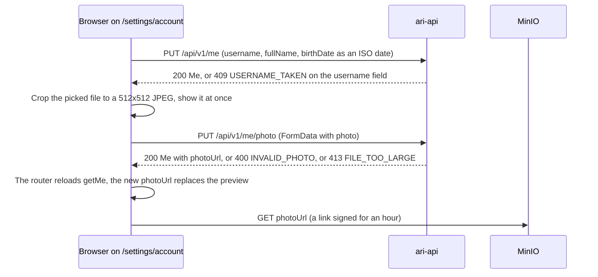

- The client sends `FormData` as multipart and leaves the content type, with its boundary, to the
  browser.
- The cropped preview stays until `getMe` brings the new `photoUrl`, so the avatar never flickers
  back to the old photo.

## 11. Reset a forgotten password

The website calls them through `@ari/data-access` (`requestPasswordReset`, `checkPasswordReset`,
`resetPassword`), never refreshing on a 401: the user is signed out, and a 401 is a bad link.

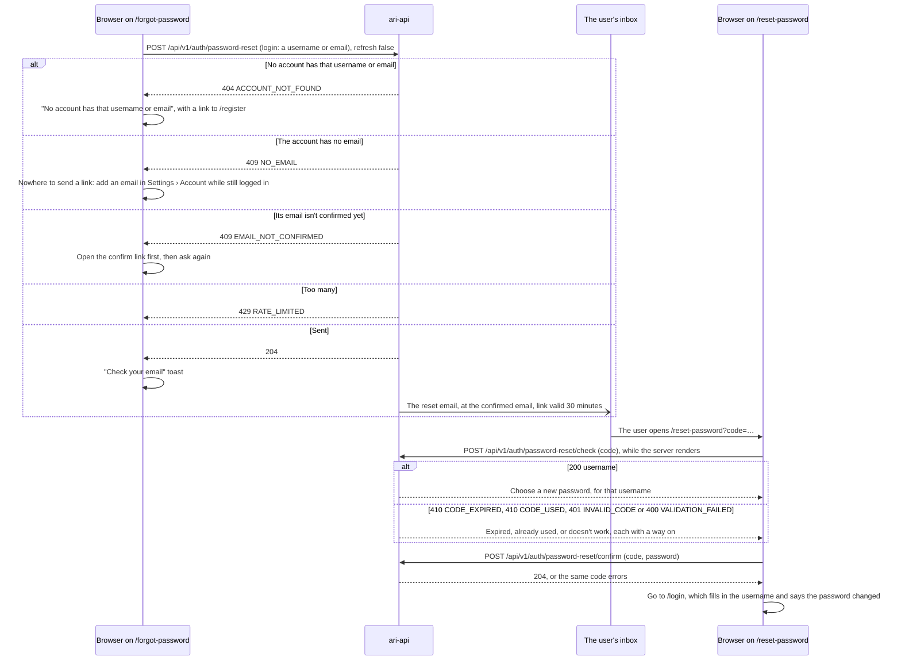

- Asking for a link says why none was sent: no account with that username or email
  (`ACCOUNT_NOT_FOUND`), an account without an email (`NO_EMAIL`), or one whose email is still
  pending (`EMAIL_NOT_CONFIRMED`; a pending email never gets a reset link). This tells anyone
  whether a username or email has an account; usernames are public through
  `/auth/username-available` already, and `RATE_LIMITED` keeps anyone from trying many emails.
- Checking doesn't use the code up, so the page checks while the server renders; only confirm
  does. A code error on confirm (the link expired while the form was open) shows the same page as
  on opening it.
- `/login` gets the username in the history state rather than the address, so it never lands in a
  bookmark or a shared link; the page reads it once mounted, as the server never sees that state.
- Saving the new password ends every session of the account, the website's and the extension's.
  The save revalidates no query, so the page doesn't check the now used link again before it moves
  on to `/login`.
- Limits: 20 requests an hour from one address, and the account's emails (reset and verify links
  together) 1 a minute, 5 a day; both answer `RATE_LIMITED`.

## 12. Sources

```mermaid
sequenceDiagram
  participant B as Browser
  participant W as ari server
  participant A as ari-api
  B->>W: GET /sources (cookies)
  par The cards
    W->>A: GET /api/v1/sources
    A-->>W: 200 PageResponse (each source with its counts, colors, newest highlight, first and latest save; nextCursor), 40, latest saved from first
  and The tabs
    W->>A: GET /api/v1/sources/counts
    A-->>W: 200 total and per kind
  end
  W-->>B: Streamed HTML with the data in it
  B->>A: GET /api/v1/sources?cursor=... (the end of the cards in view)
  B->>A: GET /api/v1/sources?kind=FILE (the Files tab; the cards stay until it answers)
  B->>W: GET /sources/{id}
  par The source
    W->>A: GET /api/v1/sources/{id}
    A-->>W: 200 the source with what is saved from it, or 404 NOT_FOUND
  and Its saves
    W->>A: GET /api/v1/saves?source={id}&order=PAGE
    A-->>W: 200 PageResponse, in page order
  end
  W-->>B: Streamed HTML
  B->>A: GET /api/v1/saves?source={id} (Newest first), then &cursor=... as the end comes into view
```

- `features/sources/queries.ts` holds the queries (`getSourcePage`, `getSourceCounts`,
  `getSource`, `getSourceSaves`). Like the Library's, they answer `failed` instead of throwing, so
  the page shows its error state with Try again. `getSource` answers null for a 404 (or a 400, an
  id ari-api could not have made): the "isn't in your Library" page.
- A source whose saves were all deleted leaves the list. Changing or deleting a save marks the
  Sources queries stale, so they load again the next time a Sources page shows.
- The sidebar's Sources count is how many sources the Library's facets list (they count over the
  whole Library and refresh after every change); the page's tabs use `/sources/counts`.
- Each source comes with the notes quoting its saves (the card's "In a note", "Quoted in"); a save's
  own "In a note" comes from the notes list's `saveIds` (section 13).

## 13. Notes

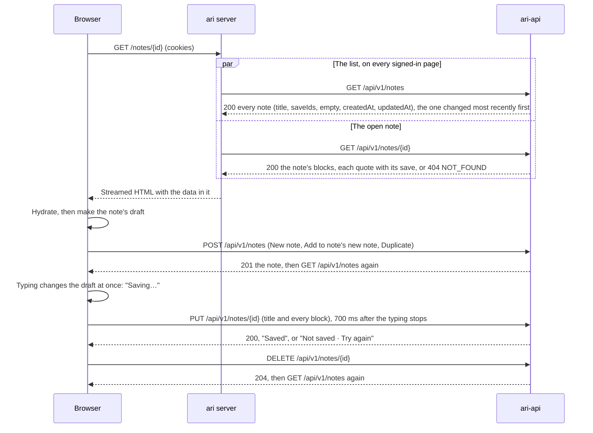

- `features/notes/queries.ts` holds the queries (`getNotes`, `getNote`) and the actions
  (`createNoteAction`, `saveNoteAction`, `deleteNoteAction`). The queries answer `failed` instead of
  throwing, so the page shows its error state with Try again; `getNote` answers null for a 404 (or
  a 400): the "isn't in your Notes" page.
- The page keeps a draft of each note it opened and sends the whole note, which replaces what
  ari-api had. A note's saves go one at a time, each with the newest draft, so an older one never
  lands last. A hidden tab saves at once; Add to note to an existing note loads it (when it isn't
  open), quotes the save at its end and saves at once.
- A quote is a save's id; ari-api answers each with the save as it is now, and the page shows the
  Library's copy when it has one (with this visit's color and comment changes). A save deleted here
  leaves the note's quotes, and deleting it marks the notes queries stale.
- Changing a note's quotes marks the Sources queries stale, as they show the notes quoting them.
