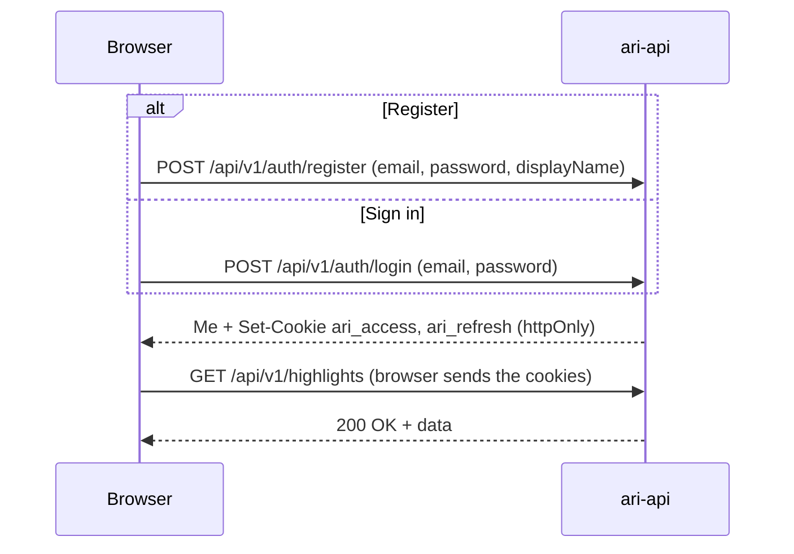
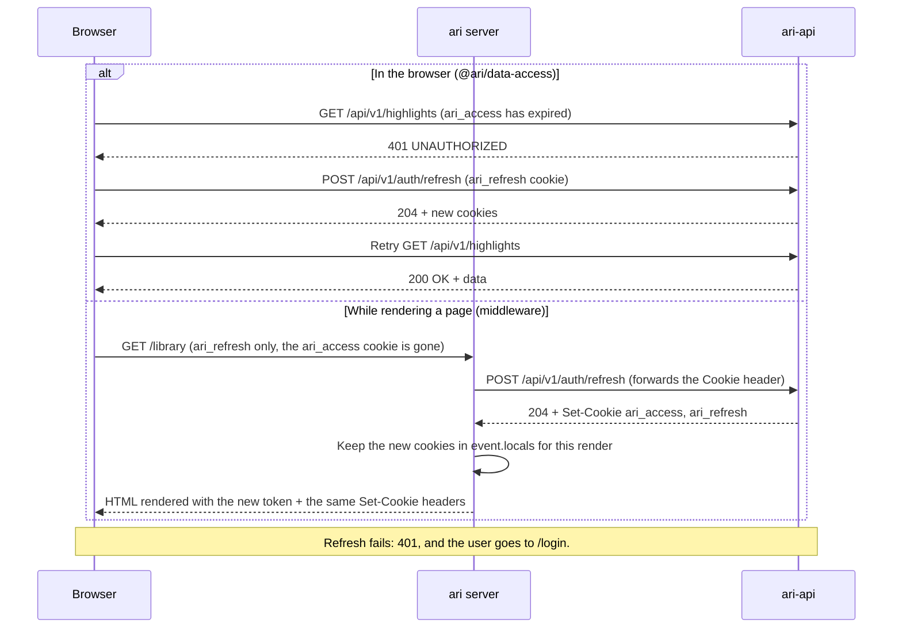
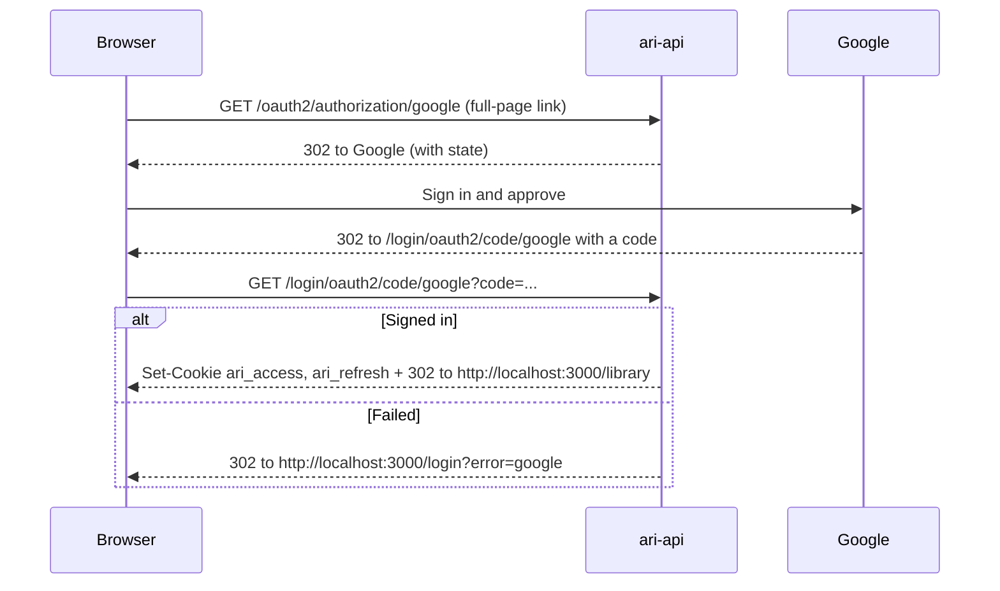
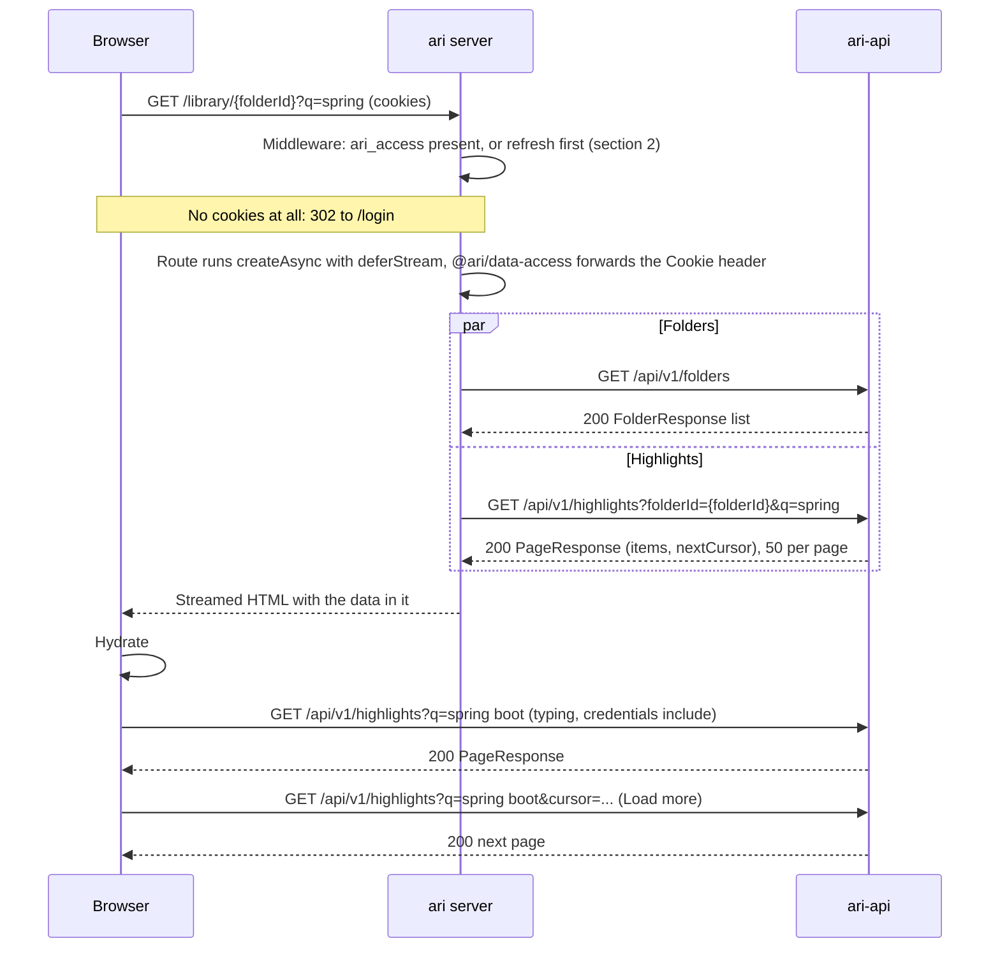
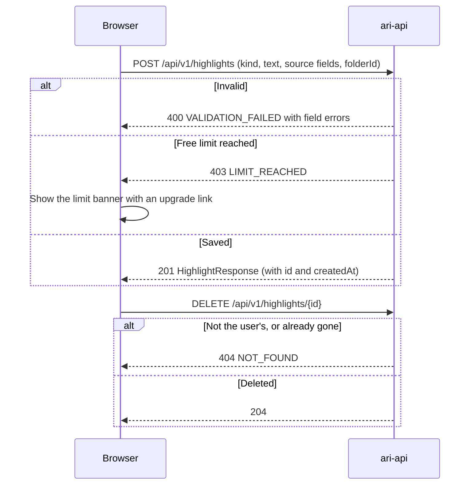
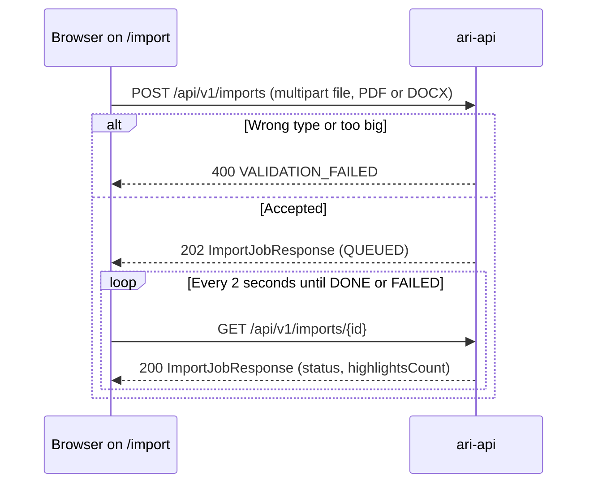
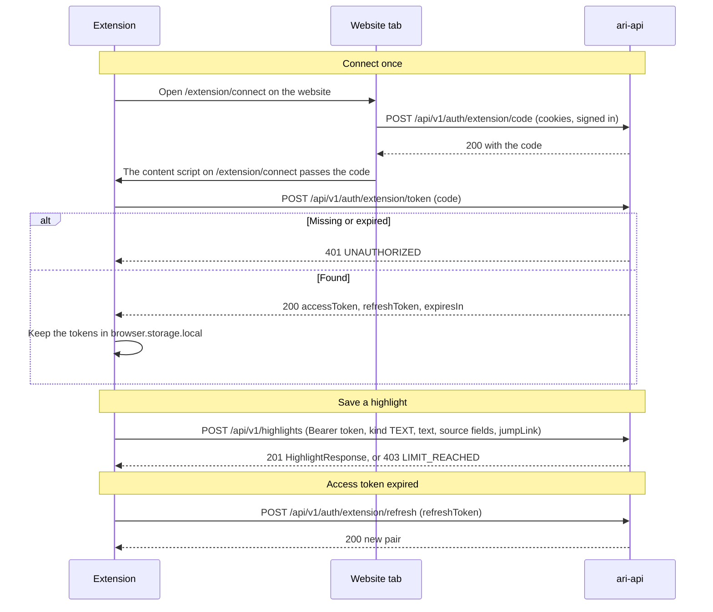
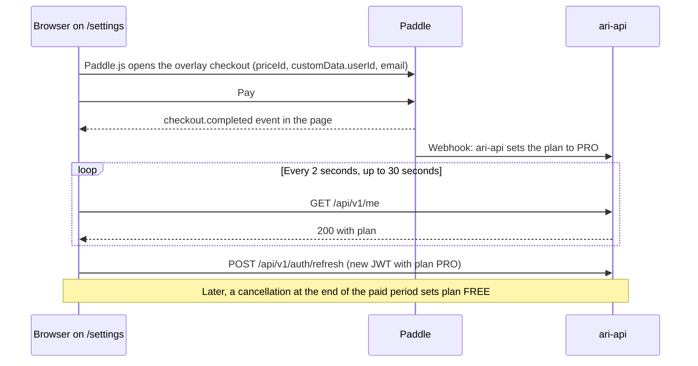

# Ari sequences

Last updated 2026-10-08. This copy keeps only what the website, the `ari` server and the extension
send and receive. The server-side steps (database, queues, webhooks) are documented in ari-api.
The rules the UI relies on are in [architecture.md](architecture.md).

1. [Register or sign in (F1)](#1-register-or-sign-in-f1)
2. [Token refresh (F1)](#2-token-refresh-f1)
3. [Sign in with Google (F9)](#3-sign-in-with-google-f9)
4. [Server-rendered library page (F2)](#4-server-rendered-library-page-f2)
5. [Save and delete a highlight, free limit (F3, F4)](#5-save-and-delete-a-highlight-free-limit-f3-f4)
6. [PDF or Word import (F11)](#6-pdf-or-word-import-f11)
7. [Save from the extension (F13)](#7-save-from-the-extension-f13)
8. [Paddle checkout (F15)](#8-paddle-checkout-f15)

## 1. Register or sign in (F1)

## 2. Token refresh (F1)

- In the browser, several 401s at once share one refresh request.
- The `ari` server refreshes only when `ari_access` is missing. The cookie expires a minute before its
  JWT, so a cookie the browser still sends is always valid.

## 3. Sign in with Google (F9)

## 4. Server-rendered library page (F2)

- `ari-api` returns only the signed-in user's data. A folder id that belongs to someone else returns
  404 `NOT_FOUND`.
- `nextCursor` is opaque: send it back as `cursor` for the next page. It is null on the last page.
- Typing in the search box waits about 300 ms, then updates `?q=` in the URL, so a reload renders the
  same results on the server.
- `q` matches the highlight text and source title. F10 turns it into full-text search behind the
  same endpoint.

## 5. Save and delete a highlight, free limit (F3, F4)

- Free means at most 500 highlights stored at once: deleting gives the save back. Pro has no limit.
  Folders don't count.
- `GET /me` returns `plan`, `savesCount` and `savesLimit`; `/settings` shows them, and the banner shows
  once `savesCount` reaches `savesLimit`.

## 6. PDF or Word import (F11)

- A job goes `QUEUED` → `PROCESSING` → `DONE` or `FAILED`, with an error code when it fails.
- An import is all or nothing: if its highlights don't fit under the free limit, none are saved and
  the job fails with `LIMIT_REACHED`.
- F5 (mock, phase 1): `POST /imports` ignores the file and returns a `DONE` job with 0 highlights.
- Photos are not imported here: OCR runs in the browser (F12) and saves through `POST /highlights`.

## 7. Save from the extension (F13)

- The code works once, for 60 seconds. If the tab is signed out, `/extension/connect` sends the user
  to `/login` first and then comes back.
- The extension calls `ari-api` from its background script, which has host permission for the API,
  so it needs no CORS entry.
- The extension builds `jumpLink` as a text-fragment URL (`#:~:text=`). Clips (F14) use the same
  `POST /highlights` with `kind CLIP` and `contentMd`.

## 8. Paddle checkout (F15)

- The plan changes when ari-api gets Paddle's webhook, not when the page sees `checkout.completed`;
  that's why the page polls `/me`.
- Downgrading deletes nothing. A Free user above 500 keeps every highlight but can't save until under
  500.
- Prices: Pro is $6/month or $48/year, the same everywhere.
